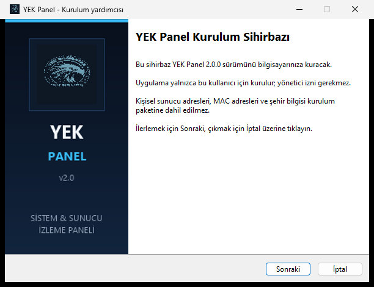

# YEK Panel

Windows 10/11 için sistem ve sunucu izleme paneli. Tek dosya olarak çalışır; kurulum gerektirmez. İsteğe bağlı kurulum sihirbazı, masaüstü ve Başlat menüsü kısayolları, kaldırma kaydı içerir.



## Özellikler

- CPU, RAM, disk, çalışma süresi, ağ hızı ve süreç takibi.
- Web sitesi, sunucu paneli, Home Assistant ve Nextcloud için durum, gecikme, SSL ve TCP port izleme.
- Hava durumu, internet gecikmesi ve dış IP.
- Araç Merkezi: pil, ağ adaptörü, DNS/ağ geçidi, diskler, ping, port testi, kronometre, geri sayım ve not.
- 7/30 günlük çevrimiçi raporu, kesinti listesi, bildirim geçmişi ve CSV dışa aktarma.
- Sunucu bazında bakım modu, yavaş yanıt eşiği ve SSL bitiş uyarısı.
- Mini mod, sistem tepsisi, sessiz saatler, günlük özet ve tema renkleri.

Tam liste: [OZELLIKLER.txt](OZELLIKLER.txt) — 100 özellik.

## İndirme ve kurulum

En son sürümü **Releases** bölümünden indirin.

- **Kurulum:** `YEK-Panel-Setup-2.0.0.exe`
  - Yalnızca mevcut kullanıcı için kurulur; yönetici izni gerekmez.
  - Varsayılan konum: `%LocalAppData%\Programs\YekPanel`
  - Masaüstü ve Başlat menüsü kısayolları oluşturulur.
  - Kaldırma: Başlat > YEK Panel > Kaldır YEK Panel veya Windows Ayarlar > Uygulamalar.
  - Kaldırırken ayarları ve geçmişi silmek isteyip istemediğiniz sorulur; varsayılan seçenek verileri korur.
- **Taşınabilir:** `YEK-Panel-2.0.0-portable.exe`
  - Kurulum gerekmez; çift tıklayarak çalıştırın.

İlk açılışta sunucu adresleri **boş** gelir. Kendi adreslerinizi **Ayarlar** ekranından girin. Kurulum paketinde kişisel sunucu adresi, MAC adresi, şehir veya geçmiş bulunmaz.

## Veri konumları

| Veri | Konum |
| --- | --- |
| Ayarlar | `%AppData%\YekPanel\settings.json` |
| Sunucu geçmişi | `%AppData%\YekPanel\history.json` |
| Bildirim geçmişi | `%AppData%\YekPanel\notifications.json` |
| CSV raporları | `%AppData%\YekPanel\rapor-*.csv` |

Uygulama klasörüne kullanıcı verisi yazılmaz. Kurulumu kaldırmak bu klasörü varsayılan olarak silmez.

## Geliştirme

Gereksinimler: .NET 10 SDK ve kurulum sihirbazını derlemek için Inno Setup 6.

```powershell
# Tek dosya yayınla
cd YekPanel
dotnet publish -c Release -o publish

# Kurulum sihirbazını derle (Inno Setup kuruluysa)
cd ..\installer
ISCC.exe YekPanel.iss
```

Kaynak yapısı:

- `YekPanel/` — WPF uygulaması ve servisler
- `installer/` — Inno Setup betiği ve sihirbaz görseli
- `release/` — derlenmiş setup ve taşınabilir exe (GitHub Releases'e yükleyin)

## GitHub'a yükleme

Bu klasör doğrudan bir Git deposu olarak kullanılabilir. `release/*.exe` ve taşınabilir exe `.gitignore` ile hariç tutulur; bunları **Releases** bölümüne yükleyin.

```powershell
git init
git add .
git commit -m "YEK Panel v2.0"
git branch -M main
git remote add origin https://github.com/KULLANICI/REPO.git
git push -u origin main
```

Ardından GitHub'da **Releases > Draft a new release** ile `v2.0.0` etiketi oluşturun ve şu dosyaları ekleyin:

- `release/YEK-Panel-Setup-2.0.0.exe`
- `release/YEK-Panel-2.0.0-portable.exe`
- `release/SHA256SUMS.txt`

## Gizlilik

- Uygulama telemetri göndermez.
- Hava durumu Open-Meteo, konum ipwho.is servislerinden ücretsiz alınır.
- Hız testi herkese açık Cloudflare, OVH, ThinkBroadband ve Hetzner sunucularını dener.
- Sunucu kontrolleri yalnızca sizin girdiğiniz adreslere yapılır.

## Notlar

- EXE dosyaları dijital olarak imzalı değildir; Windows SmartScreen uyarı gösterebilir.
- CPU/GPU sıcaklığı için uygulamayı yönetici olarak çalıştırmak gerekebilir.
- Wake-on-LAN için aynı ağda olmak ve BIOS'ta WOL'un açık olması gerekir.

## Lisans

Bu depoya henüz bir açık kaynak lisansı eklenmedi. Lisans eklemek isterseniz MIT, Apache-2.0 veya GPL-3.0 seçeneklerinden birini ekleyebilirsiniz.

---

**English:** YEK Panel is a Turkish Windows desktop dashboard for system and server monitoring. It runs as a single portable EXE and includes an optional per-user installer. Server fields are empty on first run; no personal configuration is bundled.
